<p align="center">
  
</p>

<h1 align="center">⚡ ChronoXSync</h1>

<p align="center">
  <strong>The Zero-Conflict Operating System for Higher Education & Multi-Department Academic Workload Synchronization</strong>
</p>

<p align="center">
  <em>An enterprise-grade academic temporal synchronizer built with React 19, FastAPI, Three.js 3D Shaders, SQLite/Azure SQL (3NF), HMAC SHA-256 Non-Repudiation Verification, and NLP Sentiment Triage.</em>
</p>

<p align="center">
  <a href="https://chronoxsync.vercel.app"></a>
  <a href="https://chronoxsync.onrender.com/docs"></a>
  <a href="https://github.com/ankitsingh0311/ChronoXSync"></a>
</p>

<p align="center">
  
  
  
  
  
  
  
  
  
  
</p>

---

## 🌐 Live Production Deployments & Instant Role Previews

Explore ChronoXSync directly in your browser without requiring an account. Test conflict detection, workload curves, syllabus tracking, OCR rubric extraction, and cryptographic seals using live isolated sample datasets:

| Experience / Service | Cloud Platform | One-Click Direct Link | Target Scope |
|:---|:---:|:---|:---|
| 🚀 **Public Platform Overview** | **Vercel** | **[Launch Public Tour](https://chronoxsync.vercel.app/)** | Hero value proposition, metrics, and master capabilities |
| 🎓 **Student Scholar Console** | **Vercel** | **[Open Student Console](https://chronoxsync.vercel.app/?role=student)** | 7-day spline curve, task cards, attendance buffer, focus timer |
| 👨‍🏫 **Course Faculty Console** | **Vercel** | **[Open Faculty Console](https://chronoxsync.vercel.app/?role=faculty)** | 5-unit curriculum velocity, 48h exam clash guard, grading queue |
| 👥 **Class Representative Console** | **Vercel** | **[Open CR Console](https://chronoxsync.vercel.app/?role=cr)** | OCR document parser, Section A batch broadcast, student directory |
| 🏛️ **Department Head (HOD) Console** | **Vercel** | **[Open HOD Console](https://chronoxsync.vercel.app/?role=hod)** | 16-week burnout stress heatmap, grievance NLP triage, faculty velocity |
| 🔐 **Sign In Portal** | **Vercel** | **[Open Sign In](https://chronoxsync.vercel.app/login?mode=signin)** | Authenticated access for existing institutional members |
| ✨ **Create Permanent Account** | **Vercel** | **[Open Registration](https://chronoxsync.vercel.app/signup)** | Multi-role onboarding persisted permanently to the database |
| ⚡ **FastAPI ASGI Backend** | **Render** | **[API Root](https://chronoxsync.onrender.com/)** | Asynchronous Python REST backend engine |
| 📚 **Interactive OpenAPI Docs** | **Render** | **[Swagger UI Sandbox](https://chronoxsync.onrender.com/docs)** | Interactive REST endpoint documentation & testing sandbox |

---

## 📸 Visual Showcase & Platform Tour

ChronoXSync features a high-visibility, radiant Light Theme interface with high-contrast Slate-900 typography, tactile mechanical buttons, and micro-interaction physics:

### 1. Public Landing Experience & Academic Telemetry
> Comprehensive introduction to ChronoXSync's zero-conflict operating system, live local academic clock, real-time platform statistics, and quick navigation.

<div align="center">
  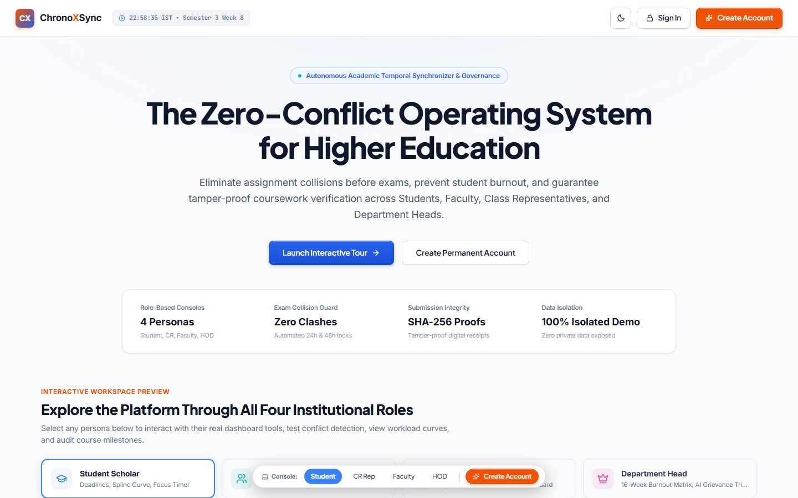
</div>

---

### 2. Four Interactive Multi-Role Workspaces

ChronoXSync adapts its entire operational workspace to match the clearance and daily workflows of all four academic stakeholders:

#### A. Student Scholar Workspace
> Features a dynamic 7-day SVG Workload Density Spline Graph calculating cognitive saturation, coursework submission queue with tamper-proof digital seals, 75% attendance buffer calculator, and spatial 3D focus Pomodoro engine.

<div align="center">
  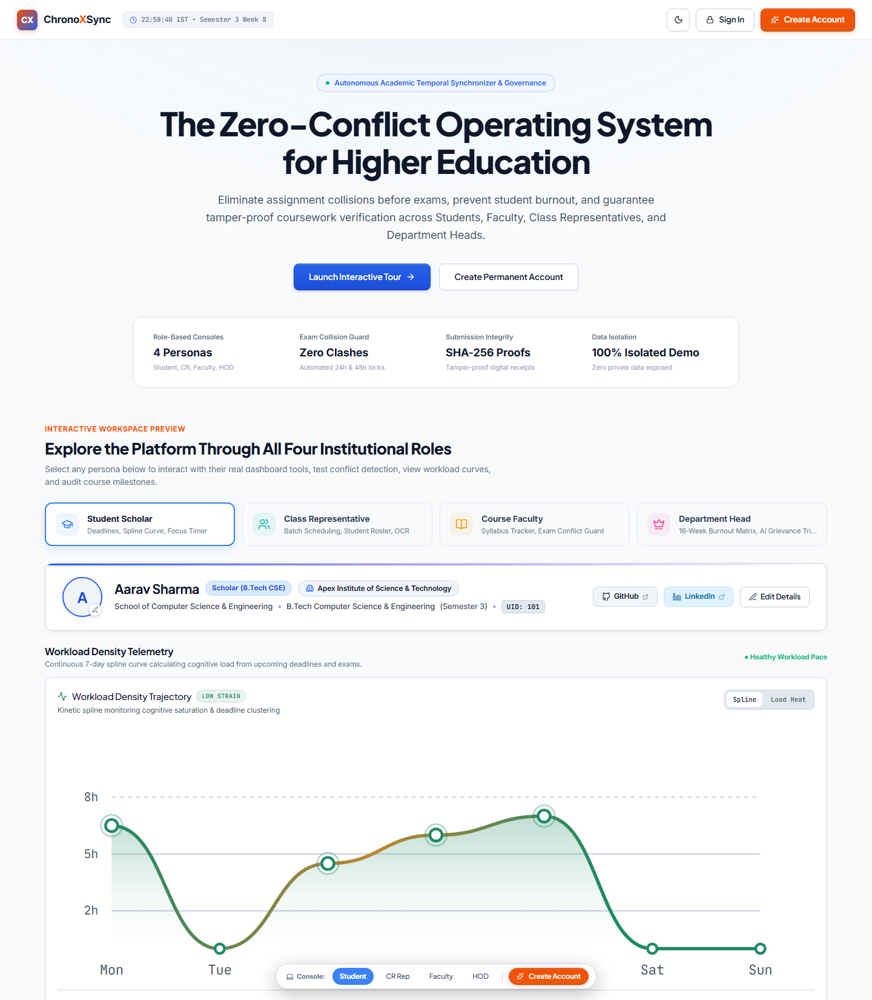
</div>

---

#### B. Course Faculty Workspace
> Equips professors with a 5-unit progressive curriculum milestone tracker with real-time syllabus completion velocity, a 48-hour exam conflict mitigation simulator, and an active student submission grading queue.

<div align="center">
  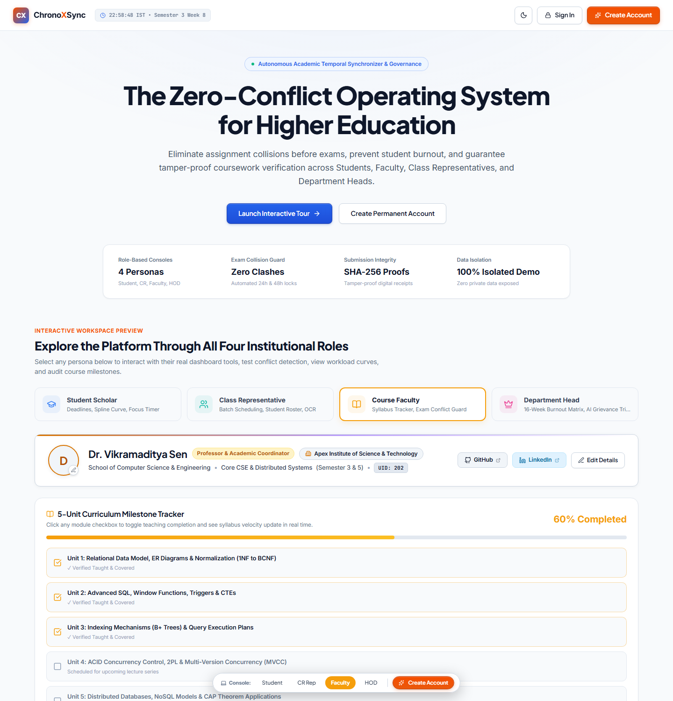
</div>

---

#### C. Class Representative (CR) Command Desk
> Provides student leaders with an automated Document OCR Rubric Parser (PDF to calendar events), a batch announcement broadcast tool dispatching to 64 scholars, and an interactive section directory roster.

<div align="center">
  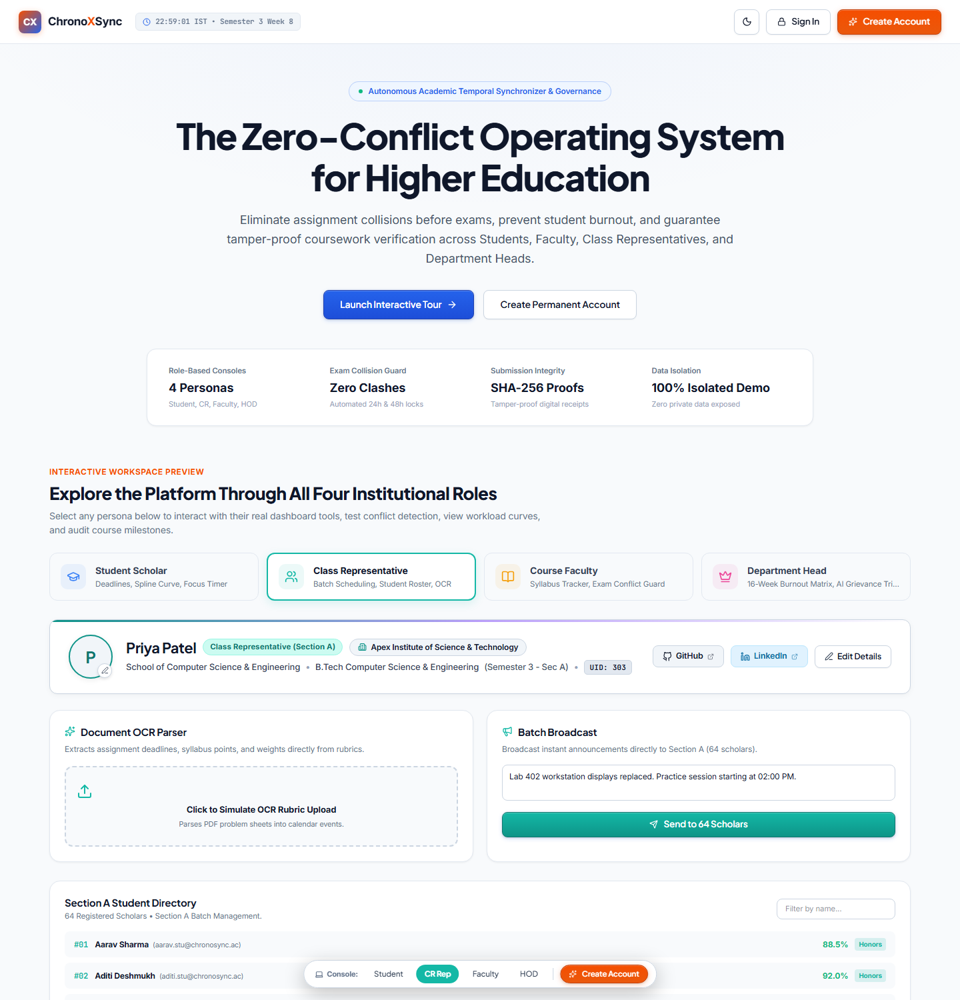
</div>

---

#### D. Head of Department (HOD) Governance Desk
> Delivers department-wide executive oversight via a branch-wide 16-Week Burnout Stress Heatmap, an anonymous student grievance sentiment NLP triage engine, and faculty fleet syllabus velocity telemetry.

<div align="center">
  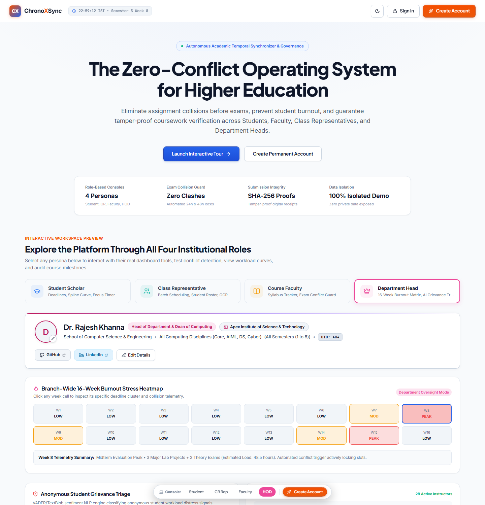
</div>

---

### 3. Verification & Compliance Subsystems

#### Cryptographic Non-Repudiation Submission Verifier
> Validates student submission receipts live against the server's cryptographic vault. Every deliverable generates an immutable 64-character SHA-256 seal with microsecond timestamps to eliminate falsified screenshots and Inspect Element fraud.

<div align="center">
  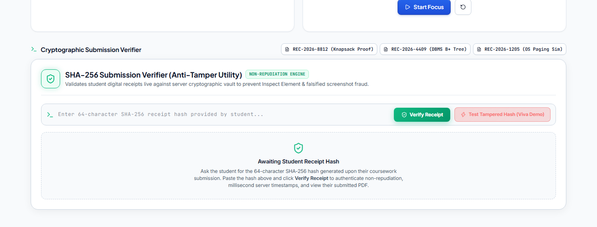
</div>

---

#### Attendance Compliance Buffer & Spatial Pomodoro Focus Engine
> Computes safe lecture cut margins against the mandatory 75% institutional threshold alongside a customized 25-minute Pomodoro focus interval timer.

<div align="center">
  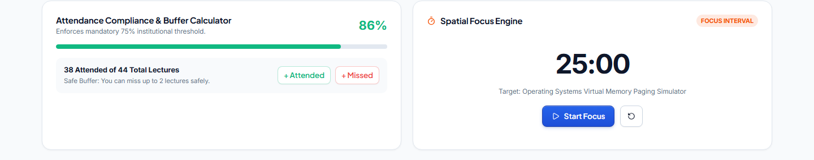
</div>

---

### 4. Master Platform Capabilities & Architecture

#### Complete Master Platform Capability Clusters
> The 6 foundational subsystems powering ChronoXSync: Collision Prevention Engine, Cryptographic Receipts, OCR & NLP Sentiment Triage, RFC-5545 iCalendar Subscription, Multi-Tenant RBAC Governance, and Enterprise SIEM Security.

<div align="center">
  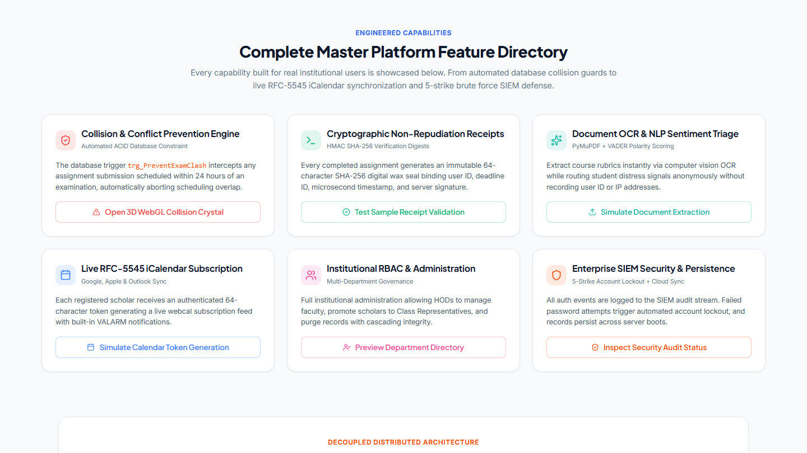
</div>

---

#### Decoupled 3-Tier Enterprise Distributed Architecture
> Clean separation of concerns across the Presentation Tier (React 19 + Three.js), Application Tier (FastAPI + ASGI), and Persistence Tier (3NF Relational Database).

<div align="center">
  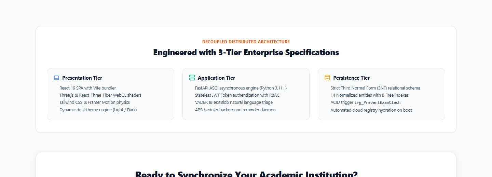
</div>

---

### 5. Secure Authentication & Multi-Role Enrollment

<div align="center">
  <table>
    <tr>
      <td width="50%" align="center">
        <b>Institutional Single Sign-On (Sign In)</b><br />
        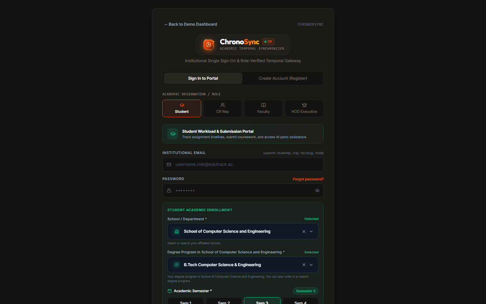
      </td>
      <td width="50%" align="center">
        <b>Enterprise Multi-Role Registration (Sign Up)</b><br />
        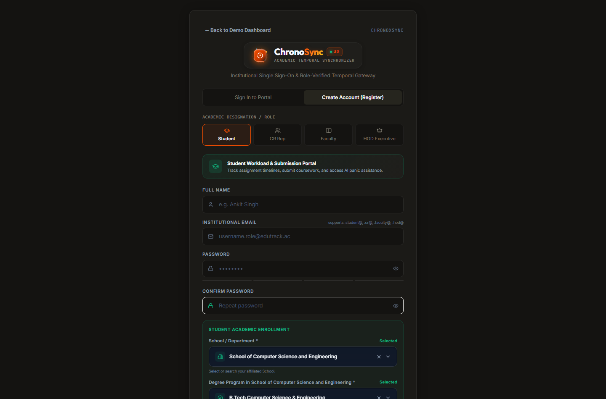
      </td>
    </tr>
  </table>
</div>

---

## 🏛️ Academic Rubric Mapping (4 Core Disciplines)

| Subject | Academic Discipline | Engineering Implementation & Code Artifacts |
| :--- | :--- | :--- |
| **Subject 1** | **RDBMS & SQL** | Strict **Third Normal Form (3NF)** relational schema (`database/schema.sql`). 14 relational entities, foreign key cascading constraints, ACID atomic status updates, pre-joined `vw_StudentDashboard` SQL views, and automated database triggers (`trg_PreventExamClash`). |
| **Subject 2** | **System Design & RBAC** | Decoupled 3-Tier Distributed Architecture (`React 19 SPA` ↔ `FastAPI ASGI` ↔ `SQLite / Azure SQL`). In-memory TTL caching layer (`backend/cache.py`), RESTful API design, and strict departmental multi-tenancy. |
| **Subject 3** | **Cloud & Hybrid Data (DP-900)** | Dual-mode hybrid architecture supporting local development with **SQLite** and cloud production with **Azure SQL** (`pyodbc`) and **Azure Blob Storage** (`azure-storage-blob`) for unstructured syllabi and submitted coursework PDFs. |
| **Subject 4** | **Cloud Security Guard** | Salted **bcrypt (12 rounds)** password hashing, signed stateless **JWT Bearer tokens (HS256)**, 5-strike brute-force account lockout guard (429 Too Many Requests), input validation, and `@require_role` access barriers. |

---

## 🔐 Multi-Tenant Departmental Isolation Matrix

ChronoXSync enforces departmental multi-tenancy at the database query level:

```
                       ┌─────────────────────────────────────────┐
                       │               ChronoXSync               │
                       │           Institutional Cloud           │
                       └────────────────────┬────────────────────┘
                                            │
         ┌────────────────────────┬─────────┴──────────────┬────────────────────────┐
         ▼                        ▼                        ▼                        ▼
 ┌───────────────┐        ┌───────────────┐        ┌───────────────┐        ┌───────────────┐
 │ School of CS  │        │  Engineering  │        │    Business   │        │   Computing   │
 ├───────────────┤        ├───────────────┤        ├───────────────┤        ├───────────────┤
 │ • HOD Admin   │        │ • HOD Admin   │        │ • HOD Admin   │        │ • HOD Admin   │
 │ • Faculty     │        │ • Faculty     │        │ • Faculty     │        │ • Faculty     │
 │ • CR Sections │        │ • CR Sections │        │ • CR Sections │        │ • CR Sections │
 │ • Students    │        │ • Students    │        │ • Students    │        │ • Students    │
 └───────────────┘        └───────────────┘        └───────────────┘        └───────────────┘
```

- **🏛️ HOD Portal**: Administers exclusively their own department's curriculum, faculty syllabus milestones, department notices, and student grievance triage.
- **👨‍🏫 Faculty Portal**: Publishes official exam dates, builds unit-wise course syllabi, and delegates coursework directly to departmental CRs.
- **👥 CR Command Desk**: Converts faculty delegations into verified classroom deadlines with OCR parsing and manages submission completion.
- **🎓 Student Timeline**: Real-time personalized academic feed displaying only deadlines, exams, and notices pertinent to their enrolled section and degree.

---

## ⚡ Core Technical Innovations

### 1. Automated Examination Collision Prevention (`trg_PreventExamClash`)
The database trigger aborts any assignment submission or lab deadline scheduled within **24 hours** of an official examination in the same department, guaranteeing student focus during evaluation periods.

### 2. Cryptographic Non-Repudiation Engine (SHA-256 Receipts)
When a student completes an assignment, ChronoXSync generates an immutable digital wax seal:
$$\text{Digest} = \text{HMAC-SHA256}(\text{student\_id} \parallel \text{deadline\_id} \parallel \text{timestamp\_ms} \parallel \text{status}, \text{SECRET})$$
The resulting 64-character hash can be entered into the anti-tamper verifier terminal to verify authenticity down to the exact millisecond.

### 3. Real-Time SVG Workload Density Spline Graph
Replaces static task lists with a kinetic spline curve modeling cognitive saturation across a 7-day rolling window. Calculates peak velocity days, saturation thresholds, and provides early warning indicators before burnout occurs.

### 4. Computer Vision OCR Rubric Extractor
Uses computer vision (`pytesseract` / PyMuPDF) to ingest assignment sheets, syllabus PDF documents, and timetable photos, automatically parsing titles, deadlines, and weights into calendar events.

### 5. NLP Sentiment Student Grievance Triage
Anonymously ingests student stress signals without storing IP addresses or student IDs. Classifies sentiment polarity via VADER/TextBlob into **CRITICAL**, **HIGH**, or **MODERATE** urgency tickets for departmental HODs.

### 6. Dynamic RFC-5545 iCalendar Synchronization
Generates live, authenticated `webcal://` feeds with embedded `VALARM` notifications, enabling two-way synchronization with Google Calendar, Apple Calendar, and Microsoft Outlook.

---

## 👥 Personas & Role Permissions Matrix

| Persona | Role ID | Operational Scope | Clearance & Permissions |
|:---:|:---:|:---|:---|
| **🎓 Student** | 1 | Degree Section | View personalized deadlines, toggle submissions with crypto receipts, 3D focus timer, anonymous grievance filing |
| **👥 Class Representative (CR)** | 2 | Class Section | Student clearance + publish deadlines, OCR document parsing, review faculty delegations, broadcast announcements |
| **👨‍🏫 Course Faculty** | 3 | Department Courses | Schedule official exams, author 5-unit course syllabi, delegate coursework to CRs, verify submission receipts |
| **🏛️ Department Head (HOD)** | 4 | Department-Wide | Full department oversight, publish master notices, triage student grievances, view audit logs, track faculty velocity |

---

## 🛠️ Complete Directory Structure

```
ChronoXSync/
├── backend/
│   ├── app.py                     # FastAPI application entrypoint & ASGI router
│   ├── auth.py                    # Bcrypt hashing, JWT bearer creation & validation
│   ├── cache.py                   # In-memory TTL caching layer for high throughput
│   ├── config.py                  # Environment configurations & database resolvers
│   ├── database.py                # Database connection factory (SQLite / Azure SQL)
│   ├── requirements.txt           # Python dependency specifications
│   ├── test_system.py             # Full end-to-end automated verification suite
│   └── test_*.py                  # Targeted unit and regression tests
├── database/
│   ├── schema.sql                 # Strict 3NF relational DDL schema (14 entities)
│   └── seed_data.sql              # Deterministic initial seed data & demo accounts
├── docs/
│   └── images/                    # High-resolution production platform screenshots
│       ├── 01_hero_landing.png
│       ├── 02_student_workspace.png
│       ├── 03_faculty_workspace.png
│       ├── 04_cr_workspace.png
│       ├── 05_hod_workspace.png
│       ├── 06_crypto_verifier.png
│       ├── 07_attendance_focus.png
│       ├── 08_platform_capabilities.png
│       ├── 09_system_architecture.png
│       ├── 10_auth_login.png
│       └── 11_auth_signup.png
├── frontend/
│   ├── index.html                 # Single page application HTML shell
│   ├── package.json               # Node.js dependencies (React 19, Vite, Three.js)
│   ├── vite.config.js             # Vite configuration with Tailwind CSS v4 & React
│   └── src/
│       ├── App.jsx                # Client-side router & role access barriers
│       ├── index.css              # Tactile developer UI tokens, typography & buttons
│       ├── components/
│       │   ├── CryptoVerifierTerminal.jsx  # SHA-256 submission verifier terminal
│       │   ├── ExecutiveProfileHeader.jsx  # Dynamic role & identity header
│       │   ├── TaskCard.jsx                # Interactive coursework deliverable card
│       │   ├── WorkloadDensityGraph.jsx    # SVG dynamic cognitive load curve
│       │   └── ConflictModal.jsx           # 3D WebGL conflict crystal visualizer
│       ├── context/
│       │   ├── AuthContext.jsx             # Persistent session & token state
│       │   └── ThemeContext.jsx            # Dual-theme engine (Light / Dark)
│       ├── pages/
│       │   ├── PublicDemoDashboard.jsx     # Master public tour & multi-role console
│       │   ├── LoginPage.jsx               # Institutional Single Sign-On
│       │   └── SignupPage.jsx              # Enterprise multi-role registration
│       └── services/
│           └── api.js                      # Axios REST client with interceptors
├── start_backend.bat              # 1-Click Windows launcher for FastAPI
├── start_frontend.bat             # 1-Click Windows launcher for React Vite
├── sync_to_github.bat             # Automated 1-Click Git commit & push synchronizer
└── README.md                      # Comprehensive project documentation & showcase
```

---

## 🚀 Local Development & Quickstart

### 1. Automatic 1-Click Launch (Windows)
Double-click the bundled scripts in the project root:
1. `start_backend.bat` — Launches FastAPI on `http://localhost:8000`
2. `start_frontend.bat` — Launches React Vite on `http://localhost:5173`

---

### 2. Manual Step-by-Step Launch

#### Backend Service (FastAPI)
```bash
# Navigate to backend directory
cd backend

# Create and activate virtual environment
python -m venv .venv

# Windows:
.venv\Scripts\activate
# macOS/Linux:
source .venv/bin/activate

# Install required dependencies
pip install -r requirements.txt

# Launch FastAPI development server
python app.py
```
*API docs available at: `http://localhost:8000/docs` (Swagger UI)*

#### Frontend Application (React 19 + Vite)
```bash
# Navigate to frontend directory
cd frontend

# Install dependencies
npm install

# Start Vite development server
npm run dev
```
*Web client accessible at: `http://localhost:5173`*

---

### 3. Automated Verification Suite
Execute the comprehensive end-to-end automated test suite:
```bash
cd backend
python test_system.py
```

---

## 🌐 Production Architecture & Cloud Delivery

```
                 ┌────────────────────────────────┐
                 │       User Web Browser         │
                 └──────────────┬─────────────────┘
                                │ HTTPS
                                ▼
         ┌────────────────────────────────────────────────┐
         │     Vercel Edge Network (React 19 + Vite)      │
         │         https://chronoxsync.vercel.app         │
         └──────────────────────┬─────────────────────────┘
                                │ RESTful API / JWT Bearer
                                ▼
         ┌────────────────────────────────────────────────┐
         │       Render Cloud Service (FastAPI + ASGI)    │
         │         https://chronoxsync.onrender.com       │
         └──────────────────────┬─────────────────────────┘
                                │ SQLite / Azure SQL
                                ▼
         ┌────────────────────────────────────────────────┐
         │   Persistent Relational Store (ACID 3NF)       │
         │   B-Tree Indexes • Bcrypt Hashes • FK Integrity│
         └────────────────────────────────────────────────┘
```

---

## 🔄 Automatic GitHub Sync

To commit and push future updates with 1-click:
- Simply run [`sync_to_github.bat`](./sync_to_github.bat) in the project root.
- It stages all modified assets, creates a structured commit message, and pushes to `origin main`, triggering automatic live continuous deployment to both **Vercel** and **Render**.

---

<p align="center">
  <b>Developed & Engineered by <a href="https://github.com/ankitsingh0311">ankitsingh0311</a></b> & <b><a href="https://github.com/KrishnaKumar-0123">KrishnaKumar-0123</a></b>
  <br />
  <em>ChronoXSync — Autonomous Academic Workload Synchronizer & Governance Engine</em>
</p>
