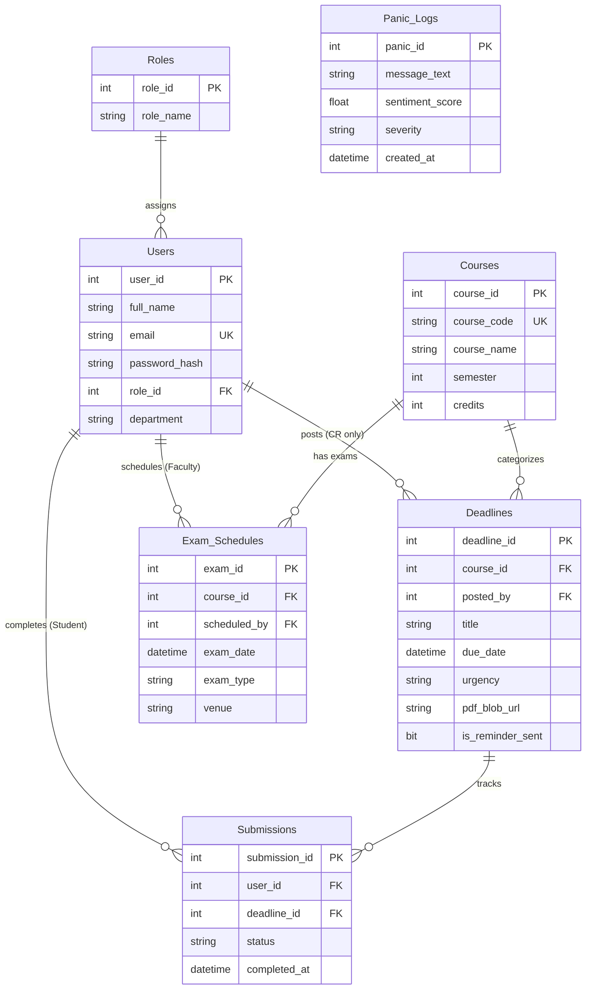

# EduTrack 3D — Academic Engineering & Viva Defense Report

**Project Title:** EduTrack 3D: AI-Powered Academic Productivity & Workload Management System  
**Level:** 2nd-Year Bachelor of Technology in Computer Science & Engineering (B.Tech CSE)  
**Architecture:** Decoupled 3-Tier Distributed Client-Server Architecture  
**Database:** Relational 3NF (Azure SQL Database & SQLite Hybrid)  
**Security Standard:** OWASP Top 10 Defense-in-Depth, salted bcrypt, stateless JWT RBAC  

---

## 1. Executive Summary & Problem Formulation

In modern undergraduate engineering curricula, students face fragmented, uncoordinated assignment deadlines originating from multiple instructors. This results in:
1. **Uncoordinated Peak Workload Clashes:** Multiple assignments overlapping with midterm examinations or quizzes within an unworkable $<24\text{h}$ window.
2. **Burnout and Academic Fatigue:** Lack of institutional visibility into student stress trends.
3. **Plagiarism & Rush Submissions:** 11:59 PM database traffic spikes causing downtime and submission failures.

**EduTrack 3D** addresses this problem by unifying crowdsourced Class Representative (CR) verified task feeds, an automated database trigger enforcing conflict avoidance, natural language sentiment processing for anonymous crisis escalation, and real-time Three.js 3D workload stress visualization.

---

## 2. Subject 1: Relational Database Management Systems (RDBMS)

### 2.1 Third Normal Form (3NF) Mathematical Normalization Proof

A relational schema is strictly in Third Normal Form if and only if it is in 2NF and every non-prime attribute is non-transitively dependent on the primary key.

#### 1NF (Atomicity)
- Every column contains atomic (indivisible) values. No repeating groups or arrays.
- `Deadlines` separates `title`, `description`, `due_date`, and `urgency`.
- `Users` holds atomic attributes: `full_name`, `email`, `password_hash`, `department`.

#### 2NF (No Partial Dependencies)
- All non-prime attributes are fully functionally dependent on the primary key (no dependency on a proper subset of any candidate key).
- In junction table `Submissions (submission_id, user_id, deadline_id, status, completed_at)`:
  $$\text{submission\_id} \to (\text{user\_id}, \text{deadline\_id}, \text{status}, \text{completed\_at})$$
  Attribute `status` depends on both the student and the deadline, eliminating partial key dependencies.

#### 3NF (No Transitive Dependencies)
- In naive schemas, tables often store `user_role_name` directly in `Users`. If $\text{user\_id} \to \text{role\_id}$ and $\text{role\_id} \to \text{role\_name}$, then $\text{user\_id} \to \text{role\_name}$ is a transitive dependency!
- **Normalization Solution:** Decomposed into a distinct lookup entity `Roles (role_id, role_name)`. Table `Users` references `role_id` exclusively.
  $$X \to Y \implies X \text{ is a superkey OR } Y \text{ is a prime attribute.}$$

### 2.2 Entity-Relationship (ER) Diagram



### 2.3 SQL Trigger Specification (`trg_PreventExamClash`)

```sql
CREATE TRIGGER trg_PreventExamClash
ON Deadlines
AFTER INSERT
AS
BEGIN
    SET NOCOUNT ON;

    -- CHECK 1: Disallow deadlines within 24h of an exam for the same course
    IF EXISTS (
        SELECT 1
        FROM inserted i
        INNER JOIN Exam_Schedules es ON i.course_id = es.course_id
        WHERE ABS(DATEDIFF(HOUR, i.due_date, es.exam_date)) < 24
    )
    BEGIN
        RAISERROR('CONFLICT: Deadline clashes with an exam within 24 hours for the same course.', 16, 1);
        ROLLBACK TRANSACTION;
        RETURN;
    END

    -- CHECK 2: Prevent workload cluster exceeding 3 tasks in 48 hours
    IF EXISTS (
        SELECT 1
        FROM inserted i
        WHERE (
            SELECT COUNT(*)
            FROM Deadlines d
            WHERE ABS(DATEDIFF(HOUR, d.due_date, i.due_date)) <= 48
              AND d.deadline_id != i.deadline_id
        ) >= 3
    )
    BEGIN
        RAISERROR('OVERLOAD: More than 3 deadlines within 48 hours. Transaction rolled back.', 16, 1);
        ROLLBACK TRANSACTION;
        RETURN;
    END
END;
```

---

## 3. Subject 2: Distributed System Design & Performance

### 3.1 3-Tier Decoupled Architecture

```mermaid
graph TD
    subgraph Client Tier (Presentation)
        React[React 18 + Vite]
        R3F[Three.js / React-Three-Fiber 3D Canvas]
        Framer[Framer Motion 3D Hover & Routes]
    end

    subgraph Application Tier (Logic & Middleware)
        FastAPI[FastAPI Gateway]
        RBAC[JWT RBAC Middleware]
        Cache[(O 1 In-Memory TTL Cache)]
        NLP[VADER / TextBlob Sentiment AI]
        OCR[PyMuPDF / Tesseract OCR]
        Cron[APScheduler 24h Cron Worker]
    end

    subgraph Data & Storage Tier (Persistence)
        AzureSQL[(Azure SQL Database 3NF)]
        Blob[Azure Blob Storage PDF Rubrics]
        PowerBI[Microsoft Power BI REST Feed]
    end

    Client Tier -->|HTTPS / JSON Bearer JWT| Application Tier
    Application Tier -->|O 1 Cache Hit| Client Tier
    Application Tier -->|pyodbc / SQLAlchemy| AzureSQL
    Application Tier -->|azure-storage-blob SDK| Blob
    PowerBI -->|GET /api/analytics/powerbi-dataset| Application Tier
```

### 3.2 11:59 PM Traffic Spike Mitigation & Cache Proof

During deadline submission peaks (typically 11:00 PM to 11:59 PM), relational databases experience connection starvation and lock escalation.
- **Cache Mechanism:** Python dictionary `COURSE_CACHE = { key: { "data": ..., "expires_at": t } }`
- **Lookup Complexity:** $O(1)$ amortized dictionary hash table lookup.
- **Cache-Aside Pattern:** Reads hit in-memory cache; deadline creation/deletion emits cache invalidation signals (`cache_invalidate`), guaranteeing data freshness without stale read anomalies.

---

## 4. Subject 3: Azure Data Fundamentals (DP-900)

### 4.1 Hybrid Cloud Storage Strategy

Academic systems handle two distinct data categories:
1. **Structured Relational Records:** Users, roles, courses, exam dates, status timestamps.
   - *Engine:* **Azure SQL Database** (ACID transactional guarantees, relational integrity, row-level locking).
2. **Unstructured Binary Documents:** Syllabus PDFs, professor assignment rubrics, project guidelines.
   - *Engine:* **Azure Blob Storage** (Cost-effective, highly durable, globally distributed block blobs).
   - *Design Pattern:* Blob binary streams directly to the Azure storage container; **only the URI pointer string** (`pdf_blob_url`) is stored in Azure SQL's `Deadlines` table.

### 4.2 Power BI Integration

The `/api/analytics/powerbi-dataset` endpoint exports denormalized academic workload dimensions:
- `course_code`, `course_name`
- `due_date` partitioned by semester week
- `urgency` severity matrix
- Completion rates ($\frac{\text{Completed}}{\text{Total}}$)

---

## 5. Subject 4: Cloud Security & Privacy Architecture

### 5.1 OWASP Top 10 Defense Matrix

| Vulnerability | Threat Description | EduTrack 3D Countermeasure |
| :--- | :--- | :--- |
| **A01: Broken Access Control** | Student accessing CR or HOD endpoints. | `@require_role([allowed_roles])` decorator inspects decrypted JWT claim; client route guard `<ProtectedRoute allowedRoles={[...]}>`. |
| **A02: Cryptographic Failures** | Plaintext password exposure in DB breach. | **bcrypt** salted hashing with 12 rounds. Rainbow tables and dictionary attacks rendered computationally infeasible. |
| **A03: Injection (SQLi / XSS)** | Malicious SQL syntax or script injection. | Parameterized queries (`cursor.execute(sql, (param,))`) + `bleach.clean(strip=True)` sanitization. |
| **A04: Insecure Design (Privacy)** | Retaliation against whistleblowing students. | **Total Anonymity Guarantee:** Student `user_id` is stripped at the controller boundary. `Panic_Logs` table contains **no foreign key** to `Users`. |

### 5.2 Mathematical Formulation of VADER Sentiment Polarity

VADER calculates normalized sentiment polarity $r$ via the sum of valence scores $s$:

$$x = \sum_{i=1}^{N} s_i$$

$$\text{Compound Score } r = \frac{x}{\sqrt{x^2 + \alpha}}$$

where default tuning parameter $\alpha = 15$.
- $r \le -0.6 \implies$ **CRITICAL** (Triggers immediate HOD priority notification).
- $-0.6 < r \le -0.2 \implies$ **MEDIUM** (Elevated workload pressure).
- $r > -0.2 \implies$ **LOW** (Standard manageable academic pace).

---

## 6. Verification Checklist for External Academic Examiners

| Requirement | Implementation File | Verification Test |
| :--- | :--- | :--- |
| **3NF Relational Schema** | `database/schema.sql` | Primary Keys, Foreign Keys, Unique constraints |
| **SQL Conflict Trigger** | `database/schema.sql` | `test_03_sql_conflict_detection_trigger` in `test_system.py` |
| **Pre-Joined View** | `database/schema.sql` | `vw_StudentDashboard` |
| **bcrypt 12-round Salt** | `backend/auth.py` | `test_01_bcrypt_authentication_and_jwt` |
| **JWT RBAC 4 Roles** | `backend/auth.py` | `test_02_rbac_authorization_matrix` |
| **O(1) Dictionary Cache** | `backend/cache.py` | Feed header cache HIT/MISS diagnostic |
| **NLP Sentiment Polarity** | `backend/ai_services.py` | `test_05_nlp_anonymous_panic_button` |
| **Smart CV OCR Extractor** | `backend/ai_services.py` | `sample_rubrics/sample_assignment_rubric.pdf` extraction |
| **3D Workload Stress Orb** | `frontend/src/components/3d/StressOrb.jsx` | Real-time Three.js Canvas with dynamic shaders |
| **3D Pomodoro Focus Timer** | `frontend/src/components/3d/FocusTimer.jsx` | Animated 3D Ring with Web Audio chime |
| **16-Week Burnout Matrix** | `frontend/src/pages/BurnoutAnalytics.jsx` | Interactive HOD density heat matrix |
